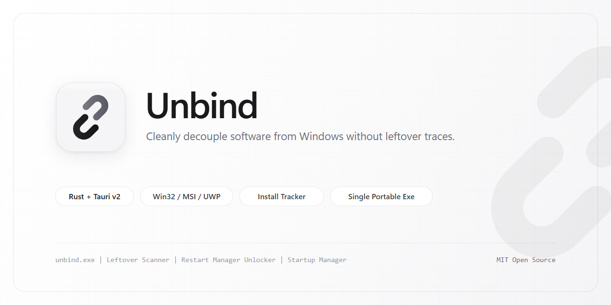

<p align="center">
  
</p>

<h1 align="center">Unbind</h1>

<p align="center">
  <strong>Cleanly decouple software from Windows without leftover traces.</strong><br />
  A lightweight, fast, portable Windows uninstaller, leftover scanner, install tracer, and startup manager built with <strong>Rust</strong>, <strong>Tauri v2</strong>, and <strong>React</strong>.
</p>

<p align="center">
  <strong>English</strong> | <a href="./README.zh-CN.md">简体中文</a>
</p>

<p align="center">
  <a href="https://github.com/Nexusyyan/unbind/releases/latest">
    
  </a>
  <a href="https://github.com/Nexusyyan/unbind/actions/workflows/ci.yml">
    
  </a>
  
  
  
</p>

---

## Download

Grab the latest prebuilt Windows binary from **[GitHub Releases](https://github.com/Nexusyyan/unbind/releases/latest)** (built automatically from source via GitHub Actions with `SHA256SUMS.txt`):

- **Portable ZIP** (`unbind-v*-x86_64-windows-portable.zip`): Includes `unbind.exe` and `portable.json`. Extract anywhere to keep all settings, registry backups, size caches, traces, and logs inside `./unbind-data`.
- **Standalone EXE** (`unbind-v*-x86_64-windows.exe`): Single-file executable storing data under `%LOCALAPPDATA%\Unbind` (Portable Mode can be toggled anytime in Settings).

## Features

- **Unified Software Discovery, Real Disk Sizing & Winget Updates**: Instant parallel discovery across 64/32-bit `HKLM` / `HKCU` Uninstall views and WinRT `PackageManager` (UWP/Store), with background real directory size measurement (including UWP package data) backed by an mtime-aware disk cache, package manager badges (`Scoop`, `Chocolatey`, `Winget`), clickable sortable columns, multi-token search, full keyboard navigation, 1-click invalid entry cleanup, and on-demand **Winget** update checks with single/batch 1-click upgrades.
- **Step-by-Step Uninstall Wizard**: Automatically detects running target processes before launch, monitors the vendor uninstaller process tree via Windows **Job Object**, and performs parallel deep leftover scanning (Registry, AppData, ProgramData, Shortcuts, App Paths, MuiCache, Explorer Context Menus, File Associations, Scheduled Tasks, UWP package data, and Windows Services cleanly stopped & deleted via SCM).
- **Safety Guardrails & In-App Backup Restore**: Hardcoded OS protection denylist, confidence grading (`Safe` vs `Review`), automatic UTF-16LE `.reg` backup export before deletion, in-app `.reg` preview and 1-click restore, Recycle Bin deletion by default, optional Windows System Restore Point (`SRSetRestorePointW`), and `MoveFileExW` delete-on-reboot fallback.
- **Force Removal, Smart Drag-and-Drop & File Unlocker**: Drop any `.exe` / `.msi` installer to choose between **Force Removal** and **Track Install**, or drop folders/shortcuts for instant forced cleanup with Windows Restart Manager (`RmStartSession`) lock inspection.
- **ETW Real-Time & Hybrid Install Tracker**: Driverless real-time kernel tracking via Windows built-in ETW providers (`Kernel-Process`, `Kernel-File`, `Kernel-Registry`) hosted inside `--elevated-worker` with strict PID-tree isolation, automatic pruning of transient `%TEMP%` files, and snapshot fusion covering Windows Services, Scheduled Tasks, custom watched drives, automatic installer exit detection, and `.ubtrace.json` import/export.
- **System Tools (Startup Manager & Portable Apps Library)**: Manage Registry `Run`/`RunOnce` (64/32-bit), Startup Folders, and third-party Scheduled Tasks natively synced with Windows Task Manager (`StartupApproved`), alongside a dedicated **Portable / Green Software Library** that extracts PE version metadata and native icons, launches apps, creates Desktop / Start Menu `.lnk` shortcuts, and runs deep leftover removal.
- **Zero-UAC Explorer Integration & Native Update Check**: Register right-click Explorer context menu entries under `HKCU` with single-instance window handoff, and check GitHub Releases directly via Windows built-in `WinHTTP`.
- **Privilege-Separated Portable Single Binary**: UI remains non-elevated while an on-demand `--elevated-worker` handles privileged tasks over a PID- and token-verified Named Pipe (one UAC prompt per session). Bilingual UI (English / Simplified Chinese) with pure neutral Light and Dark themes.

## Architecture

```text
unbind/
├── assets/               # Brand & GitHub social preview assets (1280x640)
├── crates/unbind-core/   # Decoupled Windows engine (discovery, sizing, safety, scanner, unlocker, startup, portable_apps, etw_tracker, tracker, winget, shell_ext, updater, export, ipc)
├── src-tauri/            # Tauri v2 desktop host, single-instance router, window state, Named Pipe UAC bridge
├── src/                  # Minimalist neutral React 19 + TypeScript + Tailwind CSS v4 frontend
├── CHANGELOG.md          # Structured version history
├── DESIGN.md             # Canonical UI design system & brand specification
└── AGENTS.md             # Verification commands & project invariants
```

## Development & Build

### Prerequisites
- Windows 10/11 (WebView2 Runtime built in)
- Rust stable (`x86_64-pc-windows-msvc`) + Visual Studio Build Tools (MSVC + Windows SDK)
- Node.js 20+ & `pnpm`

### Commands

```powershell
# Install frontend dependencies
pnpm install

# Run automated checks & tests
pnpm typecheck && pnpm test
cargo clippy --workspace --all-targets -- -D warnings
cargo test --workspace

# Launch in development mode
pnpm tauri dev

# Build compact portable single-file release executable
pnpm tauri build --no-bundle
# Output: target/release/unbind.exe
```

## License

MIT
