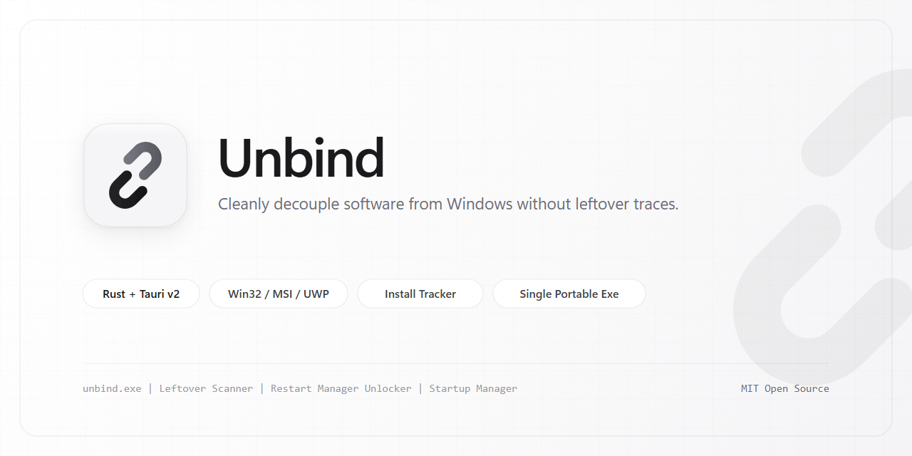

<p align="center">
  
</p>

<h1 align="center">Unbind</h1>

<p align="center">
  <strong>干净解耦 Windows 软件，不留注册表与文件残留。</strong><br />
  基于 <strong>Rust</strong>、<strong>Tauri v2</strong> 与 <strong>React</strong> 打造的轻量、高速、单文件绿色便携 Windows 卸载器、残留扫描器、安装追踪器与启动项管理工具。
</p>

<p align="center">
  <a href="./README.md">English</a> | <strong>简体中文</strong>
</p>

<p align="center">
  <a href="https://github.com/Nexusyyan/unbind/releases/latest">
    
  </a>
  <a href="https://github.com/Nexusyyan/unbind/actions/workflows/ci.yml">
    
  </a>
  
  
  
</p>

---

## 下载使用

前往 **[GitHub Releases](https://github.com/Nexusyyan/unbind/releases/latest)** 获取由 GitHub Actions 自动从源码构建的二进制包（附带 `SHA256SUMS.txt` 校验）：

- **绿色便携压缩包** (`unbind-v*-x86_64-windows-portable.zip`)：内含 `unbind.exe` 与 `portable.json`。解压到任意目录即可使用，所有配置、注册表备份、体积缓存、追踪记录与日志均保存在同目录 `./unbind-data` 中，零系统残留。
- **独立单文件版** (`unbind-v*-x86_64-windows.exe`)：开箱即用，默认将数据存于 `%LOCALAPPDATA%\Unbind`（随时可在设置页一键切换便携模式）。

## 核心特性

- **统一软件发现、异步真实体积测算与 Winget 更新**：并行扫描 64/32 位 `HKLM` / `HKCU` 卸载项与 WinRT 微软商店应用 (UWP/MSIX)；后台异步计算缺失体积（含 UWP 包及用户数据目录）并持久化 mtime 缓存；自动识别 `Scoop` / `Chocolatey` / `Winget` 来源；支持点击表头排序、多关键词空格分词搜索、方向键键盘导航、`Shift` 批量连选、失效条目一键批量清理，以及按需 **Winget** 更新检测与单个/批量一键升级。
- **分步卸载向导与深度残留扫描**：卸载前自动检测运行中进程并一键关闭；通过 Windows **Job Object** 跟踪完整卸载进程树；深度并行扫描注册表、AppData、快捷方式、App Paths、MuiCache、资源管理器右键菜单、文件关联、计划任务、UWP 应用数据及 Windows 服务（经由 SCM 规范停止并注销）。
- **多层安全护栏与应用内备份还原**：内置系统关键目录/注册表硬保护黑名单、安全/复核置信度分级、删前自动导出 UTF-16LE `.reg` 备份、应用内直接预览与一键还原、默认移入回收站、可选创建系统还原点与重启后自动删除 (`MoveFileExW`)。
- **智能拖放、强制卸载与文件解锁**：将 `.exe` / `.msi` 安装包拖入窗口可自由选择「强制卸载」或「追踪安装」；拖入文件夹或快捷方式直达强力扫描，并支持通过 Windows Restart Manager (`RmStartSession`) 检查与解除文件占用。
- **ETW 实时内核级与混合安装追踪器**：在 `--elevated-worker` 内托管免驱 Windows 内置 ETW Provider（`Kernel-Process`、`Kernel-File`、`Kernel-Registry`），严格按安装包 PID 进程树隔离系统噪声、自动剔除 `%TEMP%` 瞬态临时文件，并与快照差分融合覆盖自定义监控目录、Windows 服务、计划任务、安装包退出检测及 `.ubtrace.json` 导入/导出。
- **系统工具（启动项管理 + 便携软件库）**：集中管理注册表 `Run`/`RunOnce`（64/32 位）、启动文件夹与第三方计划任务（与任务管理器 `StartupApproved` 原生同步）；同时内置**绿色便携软件库**，支持配置便携目录、自动提取 PE 版本元数据与原生图标、一键启动、创建桌面/开始菜单 `.lnk` 快捷方式及深度清理残留。
- **免 UAC 资源管理器右键集成与原生更新检查**：支持在设置页一键注册/移除 `HKCU` 右键菜单（「使用 Unbind 强制卸载」/「使用 Unbind 追踪安装」），配合单实例唤醒；内置基于 Windows 原生 `WinHTTP` 的轻量化 GitHub 新版本检查。
- **权限分离单文件架构**：主界面始终以普通用户运行（保留拖放能力并规避 Windows 11 WebView2 管理员白屏），高权限操作按需交由经过 PID 与随机令牌双向校验的 `--elevated-worker` 通过命名管道执行（单次会话仅弹一次 UAC）。内置中/英双语与纯中性浅色/深色主题。

## 本地开发与构建

```powershell
# 安装前端依赖
pnpm install

# 运行类型检查、单元测试与 Clippy 严格门禁
pnpm typecheck && pnpm test
cargo clippy --workspace --all-targets -- -D warnings
cargo test --workspace

# 启动开发模式
pnpm tauri dev

# 构建便携单文件 Release 可执行程序
pnpm tauri build --no-bundle
# 产物位置: target/release/unbind.exe
```

## 开源协议

MIT
